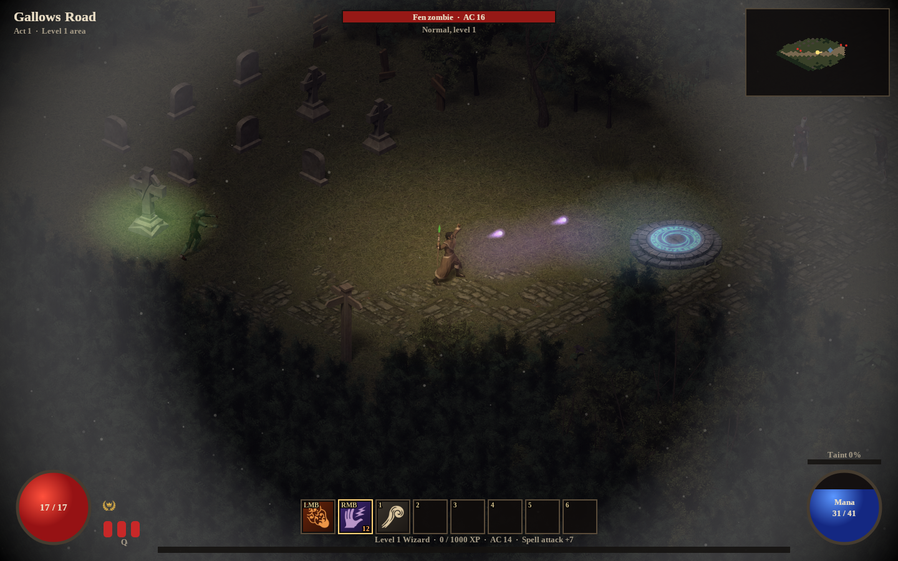
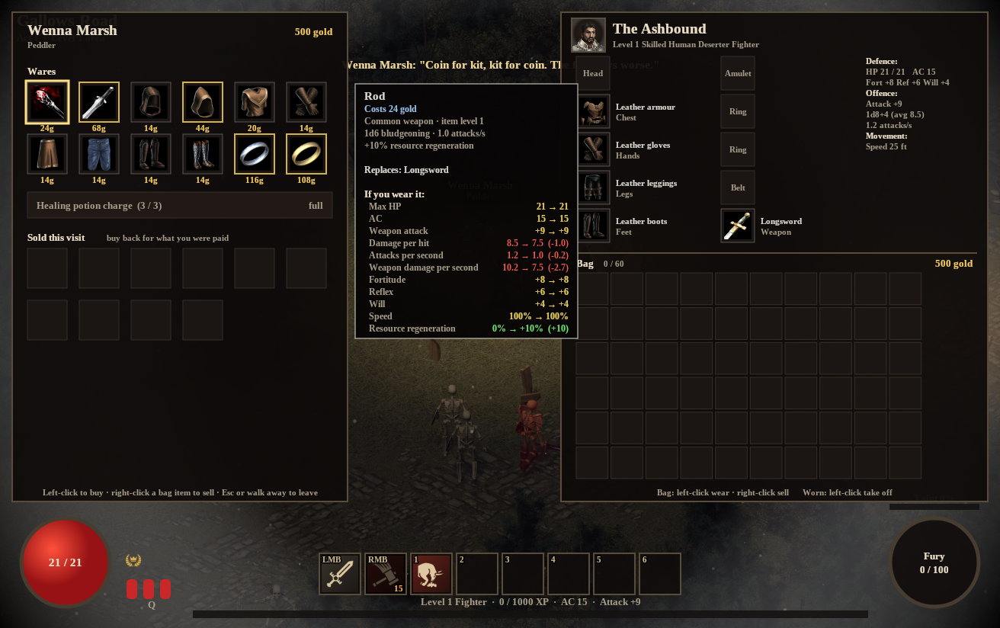
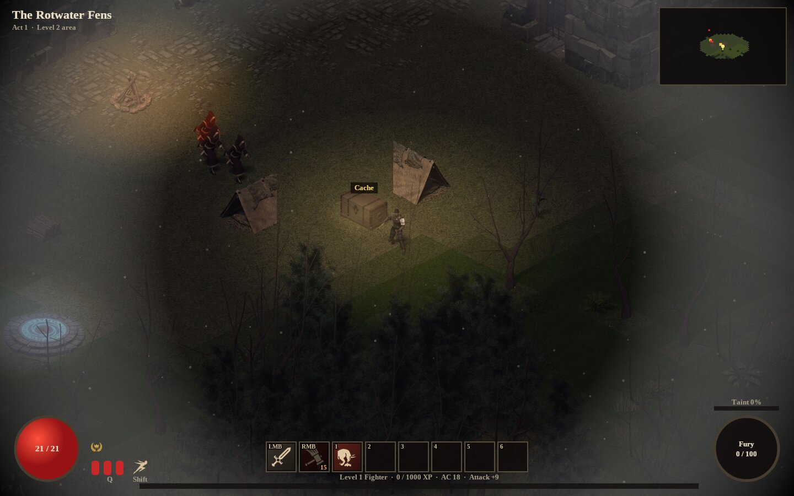
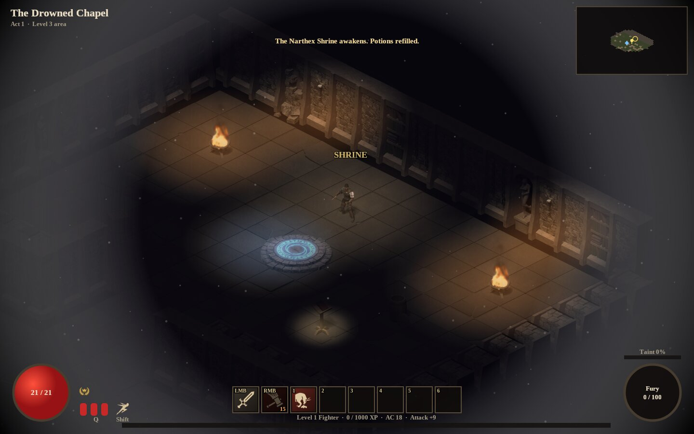
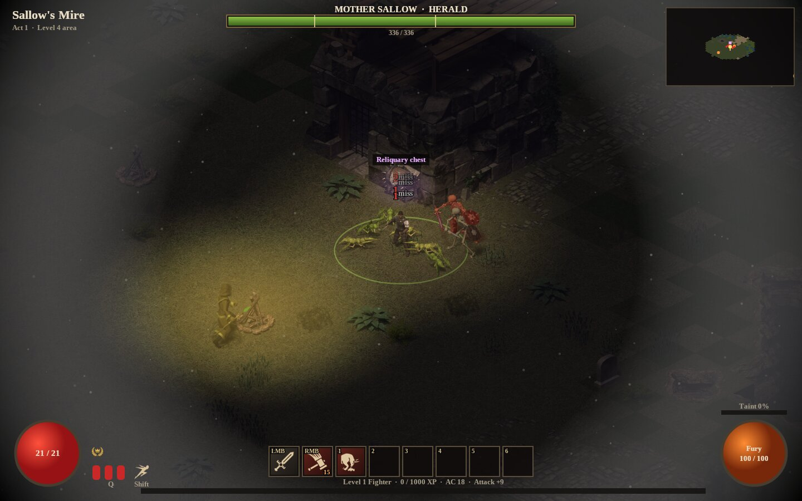
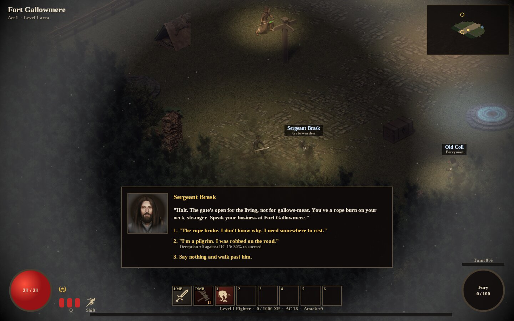
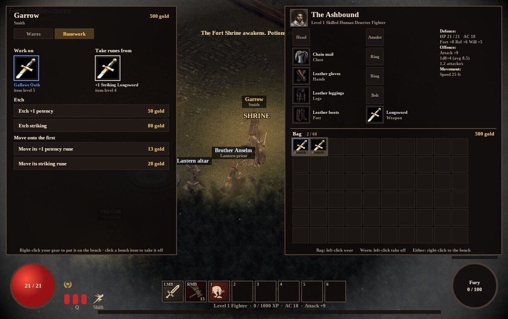
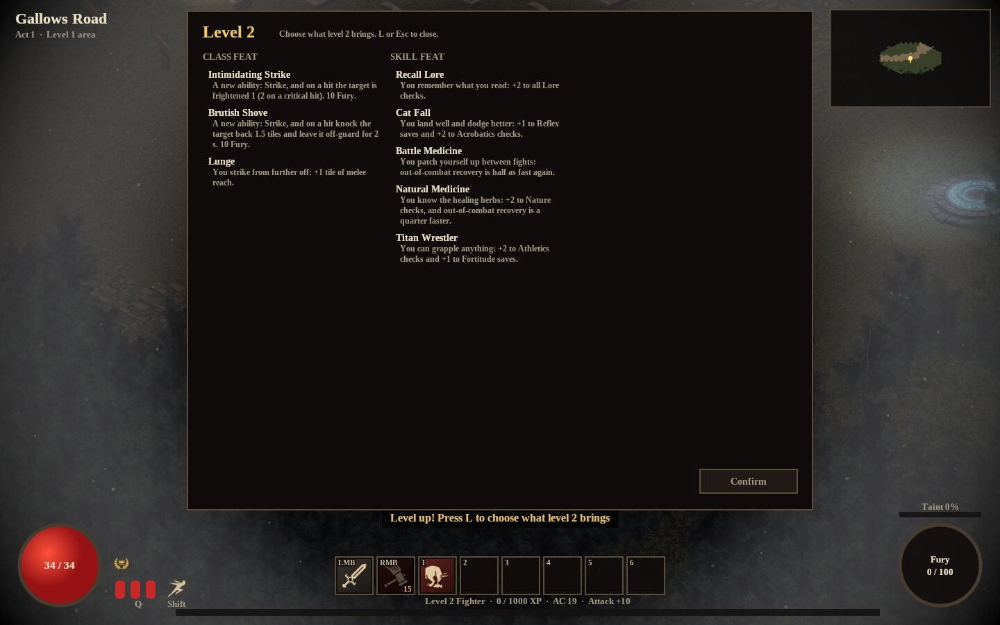
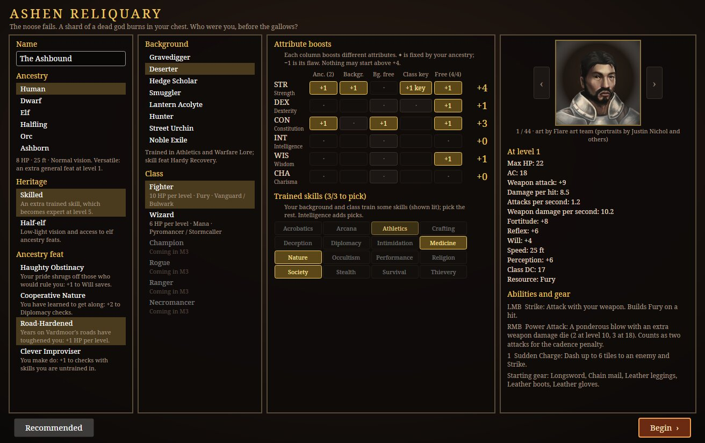

# AVAAshenReliquary

An isometric dark-fantasy action RPG in the style of Grim Dawn and Diablo, in C# / .NET 10. Character
building follows Pathfinder 2e (Remaster) conventions: ancestry, background and class, six attribute
modifiers, proficiency ranks, typed bonuses, degrees of success and conditions, all converted to real-time
combat. The full design is in [`docs/SPECIFICATION.md`](docs/SPECIFICATION.md) (exported from the shared
[Claude Doc](https://claude.ai/code/artifact/e51b5134-d298-4316-a238-95ebd9e9b470); the repo copy is the working one).





| | |
| --- | --- |
|  |  |
| *The Rotwater Fens: rot cultists in the drowned village* | *The Drowned Chapel: torchlight, braziers and a shrine in the dark* |
|  |  |
| *Mother Sallow, Herald of Rot: her boss bar and a rot pool gathering* | *Fort Gallowmere: Sergeant Brask, and a skill check in conversation* |
|  |  |
| *Garrow the smith etches runes and moves them between weapons* | *Levelling up: feats chosen on the level-up screen* |



## Running it

```bash
dotnet run --project src/AshenReliquary.App               # character creation, then Gallows Road
dotnet run --project src/AshenReliquary.App -- --fighter  # skip creation: a recommended Human Fighter
dotnet run --project src/AshenReliquary.App -- --wizard   # skip creation: a recommended Human Wizard
dotnet run --project src/AshenReliquary.App -- --mute     # no sound
```

Left-click the ground to walk (hold to keep walking), left-click a monster for your basic attack, right-click a
monster for your right-mouse ability, **1** to **6** use the other bar slots on the monster under the cursor,
**Q** drinks a potion, **I** (or Tab) opens the inventory, **C** the character sheet, click a loot label to pick it up, click a trader to trade, click a person or a notice to talk or look (answer with a click
or the number keys), click a woken shrine to open its Rift (travel to any other woken shrine), click the stash chest in the fort to store
items (right-click bag items to stash them), **J** the journal, **L** the level-up screen (when a level is waiting), **Shift** steps
(a quick dodge toward the pointer), **F5** saves,
**Escape** opens the menu (resume, save, return to the title, save and quit, or just quit without saving),
**Space** pauses, the mouse wheel zooms, **F3** shows the frame rate, render timings and the GPU's texture cache. You start as a level-1 Human Fighter beneath the gallows on Gallows Road;
fight north past the graveyard, the Hangman's Wood, the ruined farmstead, the drowned fields and the barrow field,
through the refugee camp, to the gate of
Fort Gallowmere, where Sergeant Brask asks your business.

## Status: M1 done; M2 (Act 1) in progress

Done so far: the Avalonia app; a SkiaSharp isometric renderer for the Flare art (192x96 tiles, 8-direction
sprites, the layered hero paper doll, depth sorting, see-through occluders, Act 1 colour grade, darkness with
light pools, drifting ash, vignette); Gallows Road as data (`Content/Data/zones/gallows_road.json`, generated
by `tools/gallows_road_mapgen.py`: seven stretches, 24 packs, side glades and three shrines); six Act 1 monsters with chase, melee, ranged and spawner AI; click-to-move
with A* pathfinding; real-time combat through the rules core; shrines, potions, Hero Points, XP and respawning; out-of-combat recovery (5% of max HP a second after 4 s of quiet);
a first HUD; abilities from `Content/Data/abilities.json` (Fighter: Strike, Power Attack, Sudden Charge, built on
Fury; Wizard: Ignition, Force Bolt, Staff Strike, on Mana) with cooldowns, the Flourish lockout and homing spell
projectiles; loot and inventory (`items.json`, `affixes.json`): Common, Uncommon and Rare drops by monster rank,
random affixes, potency and striking runes gated by item level, gold, healing draughts, a 10x6 bag, eleven worn
slots drawn on the paper doll, armour training, and tooltips with comparison. Character creation in Pathfinder
order (name, ancestry and heritage, background, class, boost table with only legal picks, a Recommended build,
and a live preview of the level-1 character), with a portrait picker per ancestry: 71 portraits from Flare (CC-BY-SA 3.0), Joseph Hewitt's GearHead set
(CC BY 4.0) and the Adonthell project (CC-BY-SA 3.0), cropped and graded to the game's palette by
`tools/build_portraits.py` (halflings use youthful stand-ins until real halfling art is found). Saving and loading: one JSON save per character in `~/.local/share/AshenReliquary/saves` (the app-data folder on
Windows), written atomically; autosave at shrines, on leaving through the menu and on closing the window; a title
screen to continue, load or delete characters. Loading rebuilds the character through the rules from its creation
choices and level-up boosts. The HUD: game-icons.net icons (CC BY 3.0, rasterised by
`tools/build_icons.py`) on the ability bar, buff and condition icons with values and timers, a minimap that follows
the hero and reveals as you explore (saved with the game), the target's weaknesses, resistances and conditions, a
character sheet (C), and a tooltip on every element: every number is one hover away. Audio: OpenAL Soft (the AVA1942
audio layer) with positional sound effects, footsteps, crossfading exploration and battle music, and an ambience loop,
from seven CC0 / CC-BY packs converted by `tools/build_audio.py`; volume sliders in the Escape menu. Chests in the glades and ruins hold loot for your level (click to open; a skull-chest reliquary guarded by the
Champion). Fort Gallowmere, beyond the gate, is Act 1's hub: Wenna the peddler and Garrow the smith
buy and sell (click them; right-click bag items to sell), Garrow etches and moves weapon and armour runes (his
Runework tab: right-click gear to put it on his bench), and a stash keeps what you can't carry. The fort's west gate
leads into the Rotwater Fens (levels 2–3): poison bog that sickens anyone who wades in it, plague-crawler swarms, rot
cultists who flank, and Vengeful champions who grow stronger as their pack falls. At the Fens' end the Drowned Chapel
(levels 3–4) is a dungeon in the dark: torches and moonlight show the way, what lies beyond the light is hard to hit,
and a pilgrim's lantern by the door widens your light. Beyond it, Sallow's Mire (levels 4–5) ends at Mother Sallow,
Herald of Rot: rot pools, rising corpses, a flooding arena and a last stand at her cauldron. While she lives, the road
east stays barred. Three side stories wait to be found, not handed out: a letter at the bottom of the fort's well,
a ferryman's rumour, and a scarecrow that seems to be crying. Shrines wake when you pass within 5 tiles.
The exit test (gallows to gate in one sitting) passed on 2026-10-17. Next is M2: the rest of Act 1.
`tools/screenshots.sh` renders frames headlessly from the real window.

On Linux the game takes its HiDPI scale from `GDK_SCALE` (Avalonia's X11 backend otherwise reads only `Xft.dpi`,
which Wayland desktops such as Omarchy leave unset). Set `AVALONIA_GLOBAL_SCALE_FACTOR` to choose a scale yourself.

Art is from [Flare](https://github.com/flareteam/flare-game) (CC-BY-SA 3.0) and, for portraits, also
[GearHead's Fantasy Portrait Set 1](https://gearhead.itch.io/fantasy-portait-set-1) (CC BY 4.0) and the
[Adonthell portraits](https://opengameart.org/content/adonthell-portraits) (CC-BY-SA 3.0): see `CREDITS.md` and
`assets.manifest.json`.

## M0, the rules core

M0 is the pure rules engine, with no UI yet. Its exit test is that every formula in the spec's Statistics
and Combat sections is covered by unit tests. The playable vertical slice (M1) adds the Avalonia app.

| Area | What's there | Code |
| --- | --- | --- |
| Attributes | Modifiers from +0, boosts and flaws, partial boosts above +4, level-up boosts at 5/10/15/20 | `Rules/AttributeSet.cs` |
| Proficiency | Untrained 0, trained to legendary = 2 per rank + level, per-class rank tracks | `Rules/Proficiency.cs`, `Content/Definitions.cs` |
| Bonus stacking | Item, status and circumstance: best bonus and worst penalty of each; untyped all add | `Rules/Modifier.cs` |
| Checks | d20 + modifier vs DC, four degrees of success, natural 20/1 steps, flat checks, odds for dialogue checks | `Rules/Check.cs`, `Rules/Dice.cs` |
| Character creation | Ancestry, background, class key attribute and four free boosts, with every rule validated | `Characters/CharacterBuilder.cs` |
| Derived stats | Max HP, AC with DEX cap, attack, damage, saves, Perception, detection range, class and spell DC, speed | `Characters/Character.cs` |
| Strikes | Cadence penalty for attacks inside the weapon's swing time (-2/-4, agile -1/-2), striking dice, deadly, fatal, graze, stagger | `Combat/Strike.cs`, `Combat/AttackCadence.cs` |
| Damage | Degree multiplier, immunity, resistance, weakness, persistent damage with a DC 15 flat check to end | `Combat/Damage.cs`, `Combat/PersistentDamage.cs` |
| Conditions | Frightened decay, stun cap and immunity, boss diminishing returns, off-guard, clumsy, enfeebled, stupefied, drained, slowed, sickened | `Combat/Conditions.cs` |
| Survival | Hero Points, revive at half HP, charge-based potions, the Taint meter | `Combat/Survival.cs` |
| Action timing | 0.5 s per action, attack, cast and move speed with their caps, cooldown reduction | `Combat/ActionTiming.cs` |
| Creatures | Level-based AC, attack, save DC, HP and strike damage, scaled per rank for one hero; solo pack budgets | `Creatures/` |
| Progression | Per-level gains table, 1,000 XP per level, death penalty, difficulty modes | `Progression/` |

Ancestries, backgrounds and classes are embedded JSON in `src/AshenReliquary.Core/Content/Data/`.
All randomness goes through `IRandomSource`, so a seed reproduces every roll and tests script the dice.

## Building and testing

```bash
dotnet build AVAAshenReliquary.slnx
dotnet test AVAAshenReliquary.slnx
```

GitHub Actions (`.github/workflows/build.yml`) builds and tests every push. Publishing and releases are
added with the App project in M1.

## Licence

The code is MIT (see `LICENSE`). The game mechanics follow Pathfinder 2e Remaster rules published under the
ORC licence. The Pathfinder name, setting and trademarks are not used.
